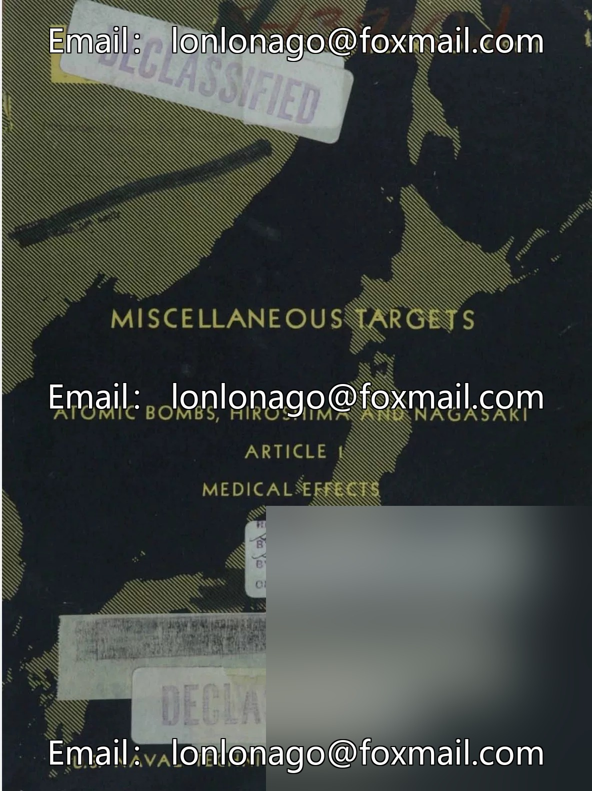
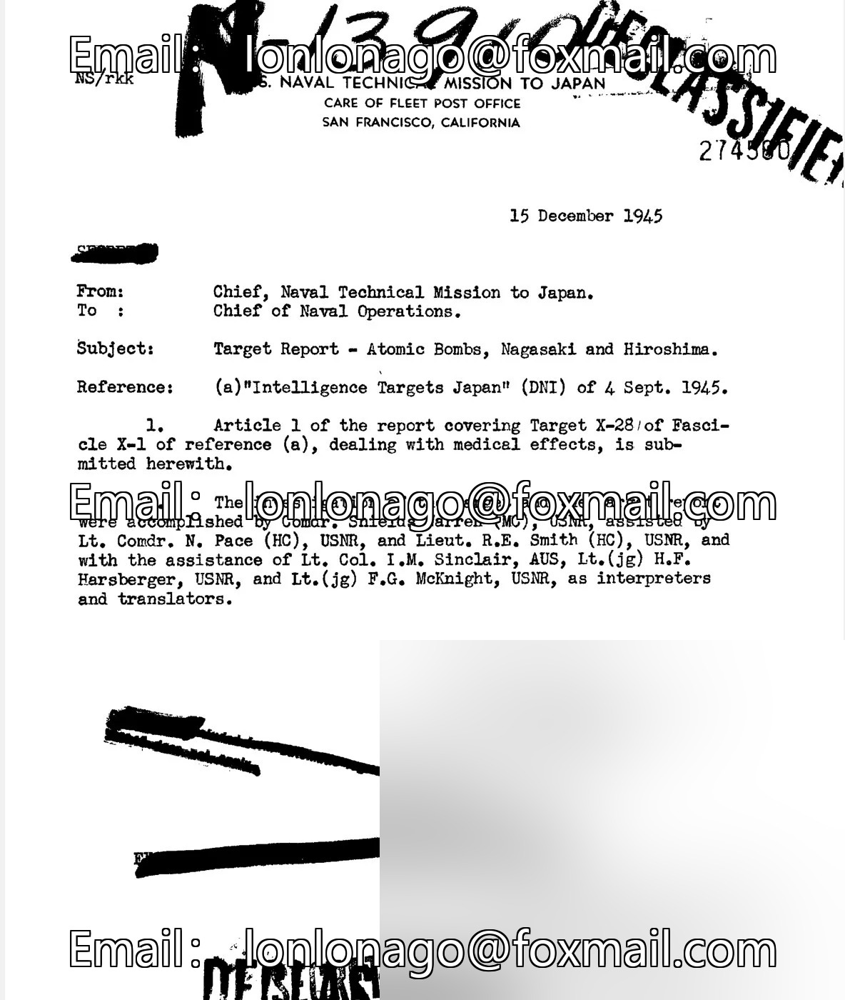
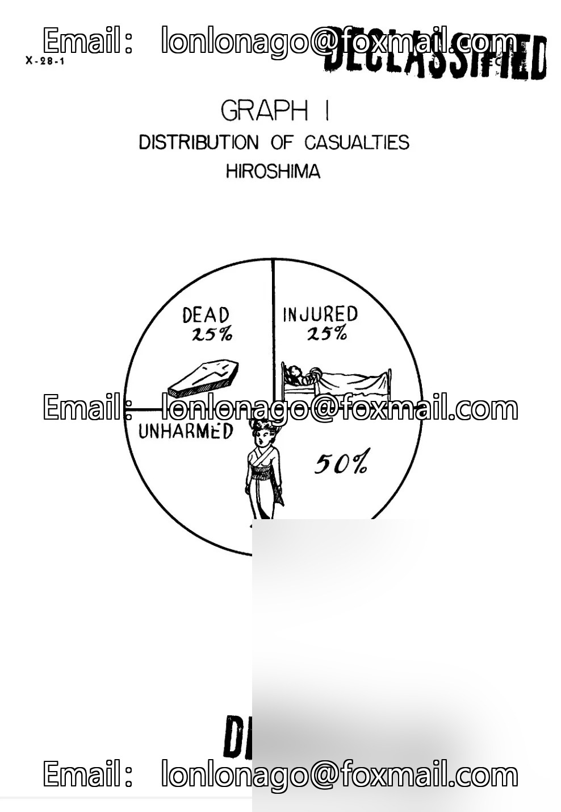
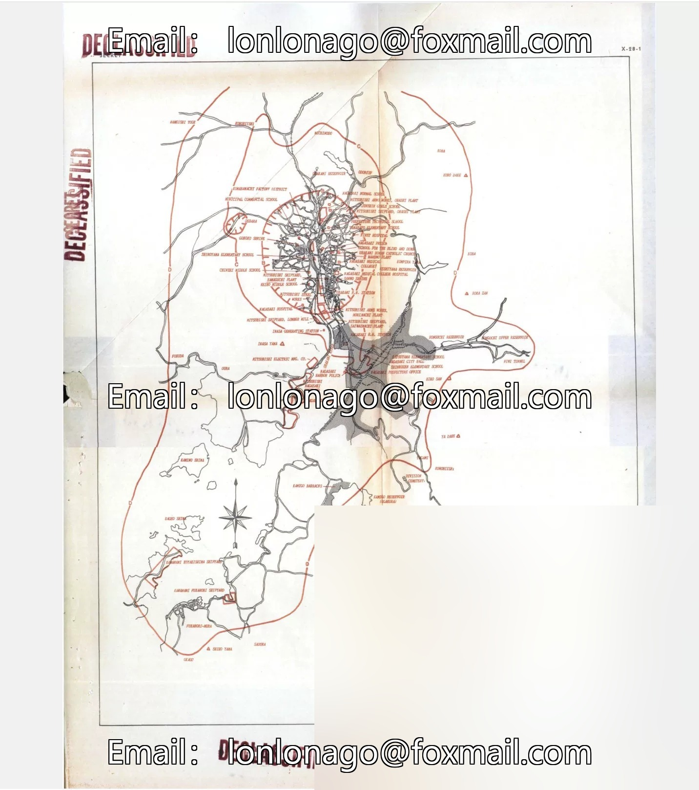
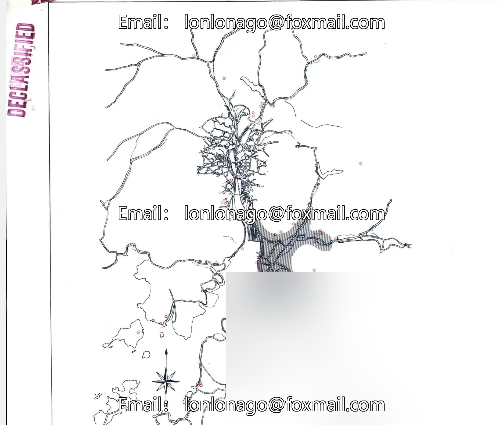
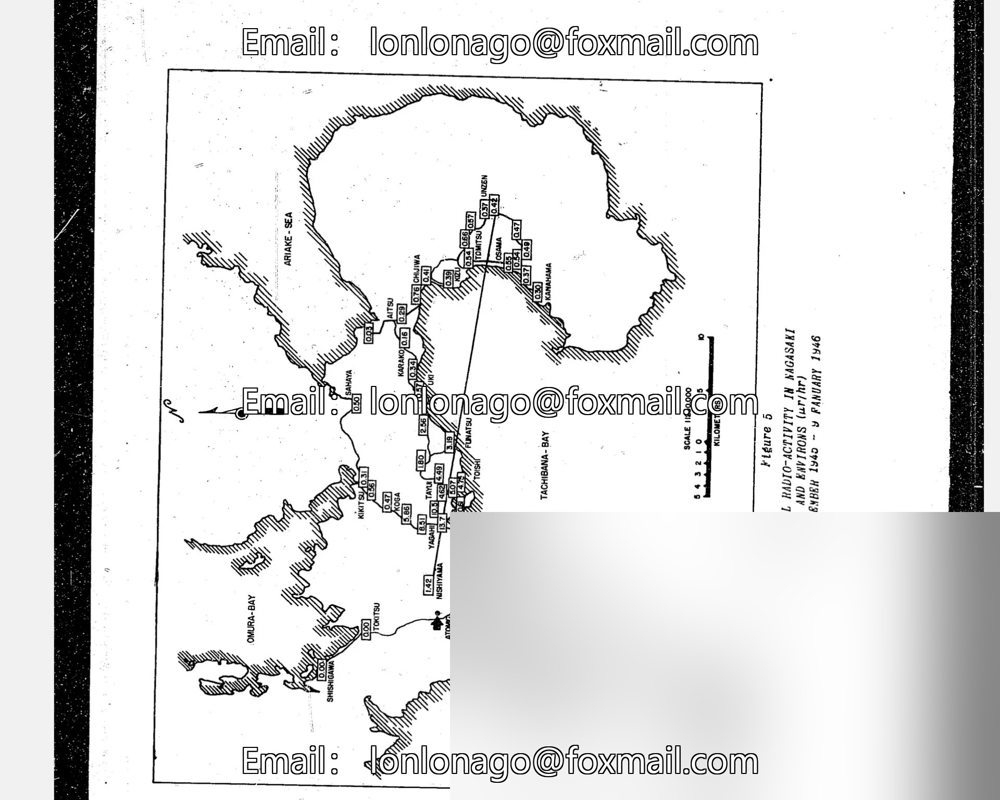

# The US Navy Technical Delegation released the "Nuclear Bombs on Hiroshima and Nagasaki" on December 15, 1945.

## Body

The *Report on Targets for Nuclear Bombing of Hiroshima and Nagasaki*, released by the United States Navy Technical Delegation on December 15, 1945, decrypted version PDF.
1. Main Content
1. Analysis of medical impact from nuclear bombs
2. Assessment of destruction extent of Hiroshima and Nagasaki
3. Radiation distribution map
4. Casualty statistics and chart of target areas
5. Detailed map of the destruction scope
2. Characteristics of the document
Authority:
Official original archive materials, released at the end of 1945
Importance:
Important research on the effectiveness of U.S. military nuclear weapons during World War II
Comprehensiveness:
Covers medical impact, urban destruction, radiation distribution and other multiple dimensions
Applicable population:
Historical researchers
Military enthusiasts
Nuclear science enthusiasts
are replicable, cannot be returned after sale.

This is a decrypted PDF report by the U.S. Navy technical mission released on December 15, 1945, on the Hiroshima and Nagasaki atomic bombing targets, covering medical effects, urban destruction assessments, radiation distribution, casualty statistics and detailed destruction maps, along with relevant archive identifiers and the issuing authorities.

<!-- AI_ENRICHED -->

## Images

## Payment

Here is a pay link on Stripe ( https://buy.stripe.com/3cs8yP7sY87d0vu9AB ). Please contact me lonlonago@foxmail.com after funding $89, and I will send you a complete data files , thank you!

